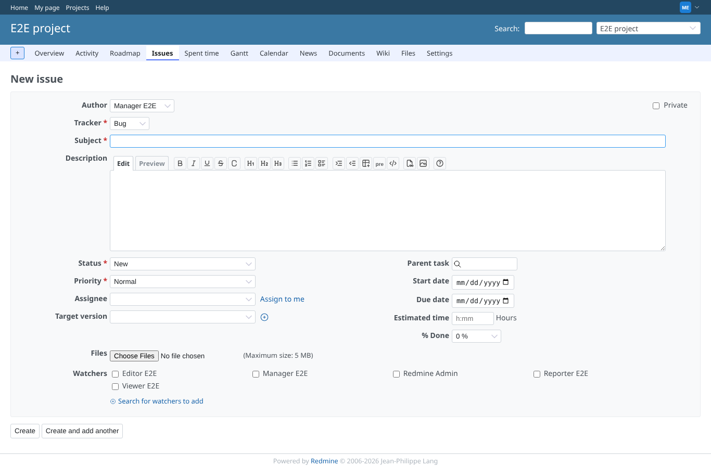
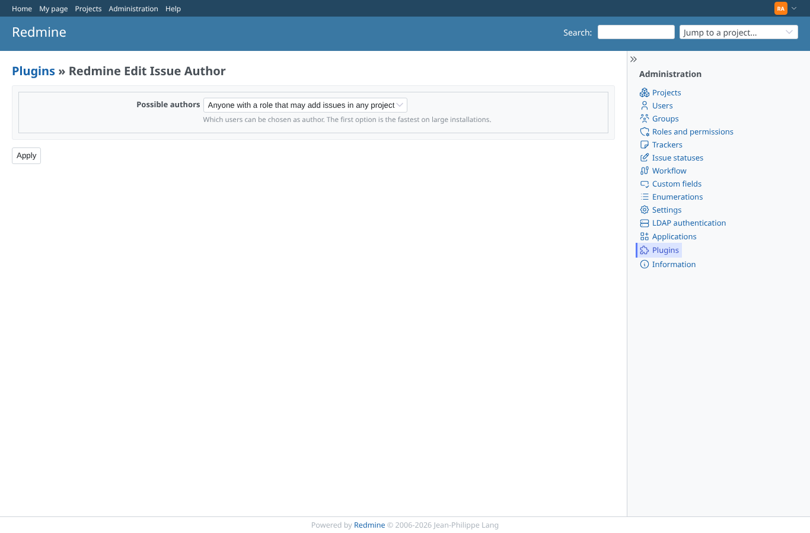
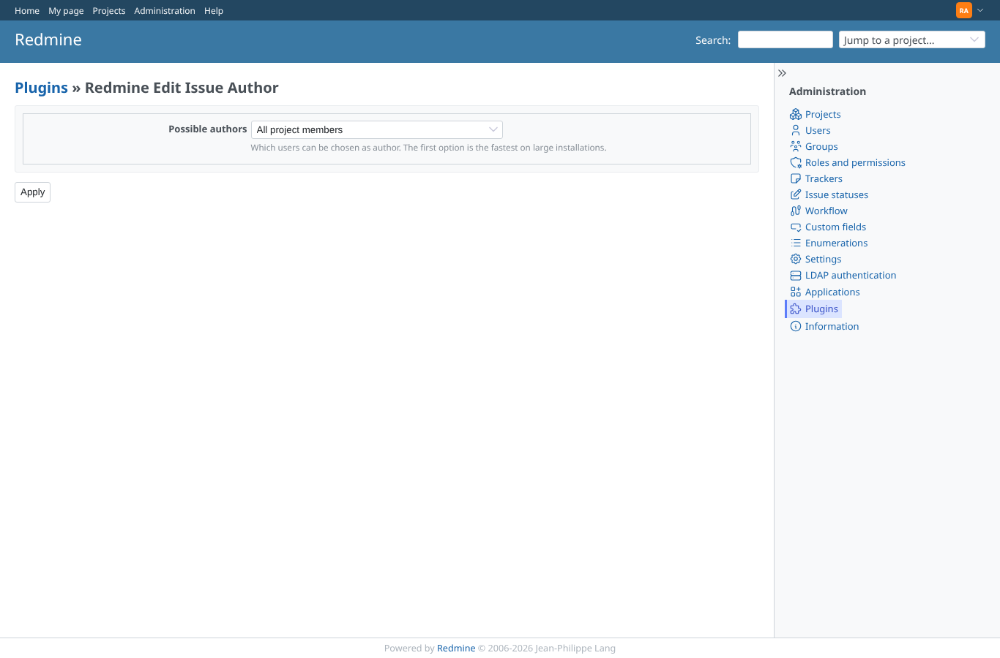
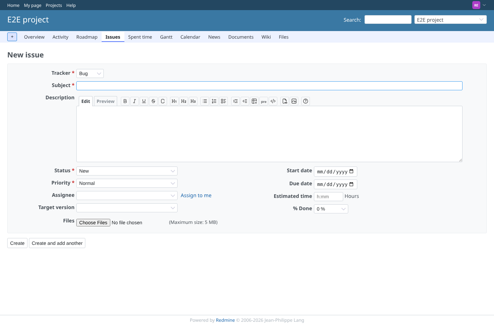

# members-scope-setting

Run 2026-10-15T04:20:55.510Z against http://127.0.0.1:3000.

| screenshot | user | URL | shows |
|---|---|---|---|
|  | admin | `/settings/plugin/redmine_editauthor` | Plugin settings as shipped, selected: project_add_issues |
|  | admin | `/settings/plugin/redmine_editauthor` | Plugin settings, possible authors: project_add_issues |
|  | manager | `/projects/e2e-project/issues/new` | Project members who may add issues: Editor E2E, Manager E2E, Redmine Admin, Reporter E2E |
|  | admin | `/settings/plugin/redmine_editauthor` | Plugin settings, possible authors: any_role |
|  | manager | `/projects/e2e-project/issues/new` | Anyone with such a role in any project: Editor E2E, Elsewhere E2E, Manager E2E, Redmine Admin, Reporter E2E |
|  | admin | `/settings/plugin/redmine_editauthor` | Plugin settings, possible authors: project_members |
|  | manager | `/projects/e2e-project/issues/new` | All project members: Editor E2E, Manager E2E, Redmine Admin, Reporter E2E, Viewer E2E |
|  | reporter | `/projects/e2e-project/issues/new` | Without the plugin permission there is no author field in any stage |
|  | outsider | `/settings/plugin/redmine_editauthor` | The setting page is for administrators only |
|  | admin | `/settings/plugin/redmine_editauthor` | Plugin settings, possible authors: project_add_issues |
